# Nexsync ⚡💧🔥

**A database-driven utility management system for electricity, water and gas providers.**

Nexsync replaces manual record-keeping for utility companies. It manages customers, meters and readings, generates bills from consumption, tracks full and partial payments, and produces reports for management, all on a carefully designed and normalised SQL Server database.

Built for **PUSL2019 Information Management & Retrieval** (Group 115) at NSBM Green University / University of Plymouth.


🎥 **[Watch the demo & presentation](https://liveplymouthac-my.sharepoint.com/:v:/g/personal/10967094_students_plymouth_ac_uk/IQCC_mjEIXwHQptTJ-Yxw7FaAXd7L2MhAhLu_N5I4RZ53wQ?nav=eyJyZWZlcnJhbEluZm8iOnsicmVmZXJyYWxBcHAiOiJPbmVEcml2ZUZvckJ1c2luZXNzIiwicmVmZXJyYWxBcHBQbGF0Zm9ybSI6IldlYiIsInJlZmVycmFsTW9kZSI6InZpZXciLCJyZWZlcnJhbFZpZXciOiJNeUZpbGVzTGlua0NvcHkifX0&e=pcB7Jc)**

<p align="center">
  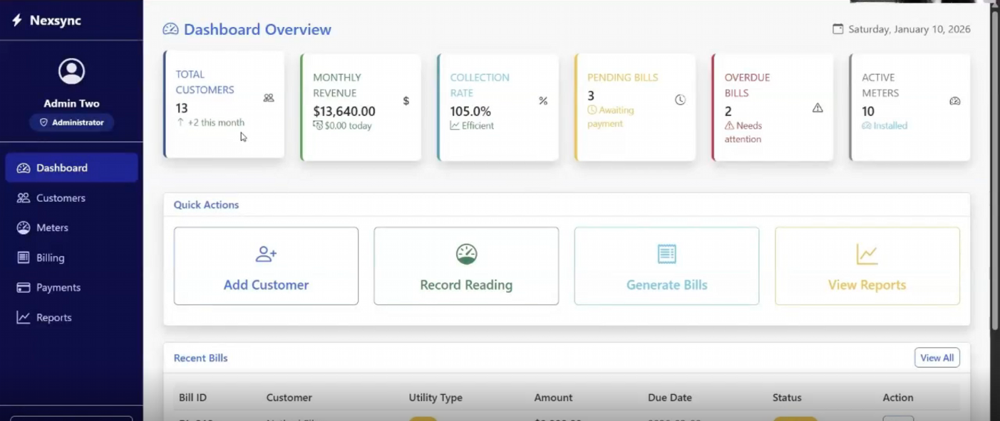
</p>

---

## ✨ Features

### 🌐 Web application
- **Login with role-based routing**: staff go to the admin dashboard, customers go to their own dashboard
- **Dashboard** with live statistics (customers, revenue, unpaid bills, and more)
- **Customer management**: register and manage residential, commercial, industrial and government customers
- **Meter management**: track meters, utility type, installation date and status
- **Billing**: generate bills from meter readings and edit existing bills
- **Payments**: record full or partial payments by cash, card, online transfer or cheque, and print receipts
- **Reports and analytics**: revenue, collection rate, outstanding balance and meter health, with CSV and PDF export
- **Customer dashboard**: customers can see their own bills and payments

### 🗄️ Database features
- **12-table schema** normalised to **3NF**
- **Supertype/subtype hierarchies** for utilities and users
- **Triggers**
  - Update a meter's last reading date when a new reading is entered
  - Mark a bill as **Paid** once total payments cover it (supports partial payments)
- **User-defined functions**
  - Tiered **late fee** calculation (0–7 days: 2% · 8–30 days: 5% · 31+ days: 10%)
  - **Monthly consumption** per customer and utility type
- **Views**
  - `vw_UnpaidBills`: unpaid bills with days overdue and late fees
  - `vw_MonthlyRevenue`: revenue by year and month
- **Stored procedures**
  - `sp_GenerateBill`: calculates charges from readings and tariffs
  - `sp_ListDefaulters`: lists customers with overdue bills
- **Indexes** for foreign keys, frontend searches and reports, including a filtered index for overdue bills and computed year/month columns on payments

---

## 📸 Screenshots

### Admin portal

<table>
  <tr>
    <td align="center">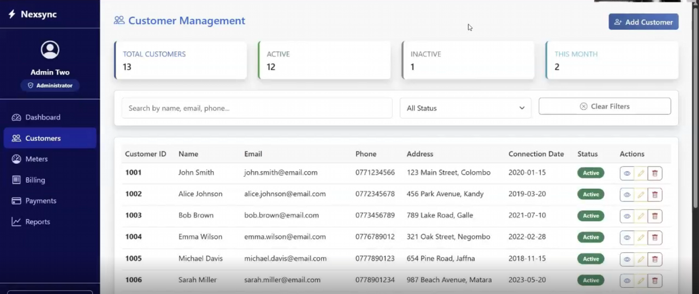<br><b>Customer management</b></td>
    <td align="center">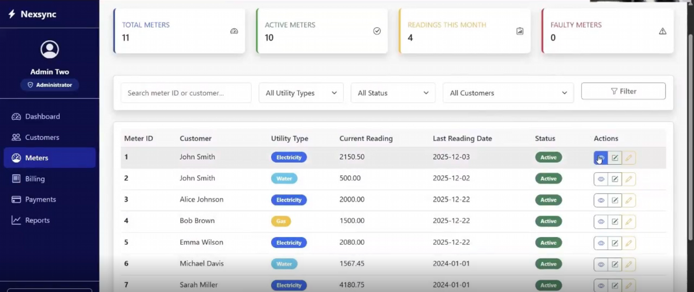<br><b>Meter management</b></td>
  </tr>
  <tr>
    <td align="center">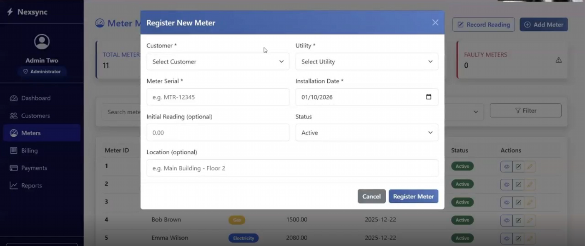<br><b>Register a meter</b></td>
    <td align="center">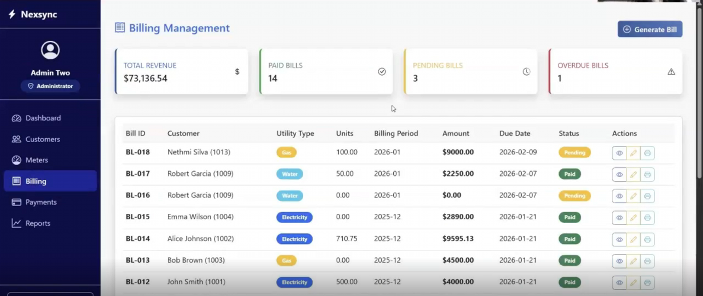<br><b>Billing management</b></td>
  </tr>
  <tr>
    <td align="center">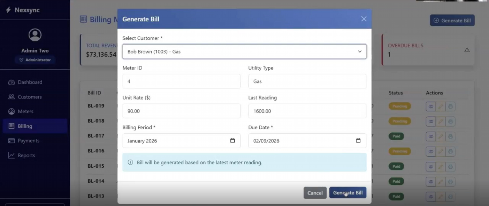<br><b>Generate a bill</b> from meter readings</td>
    <td align="center">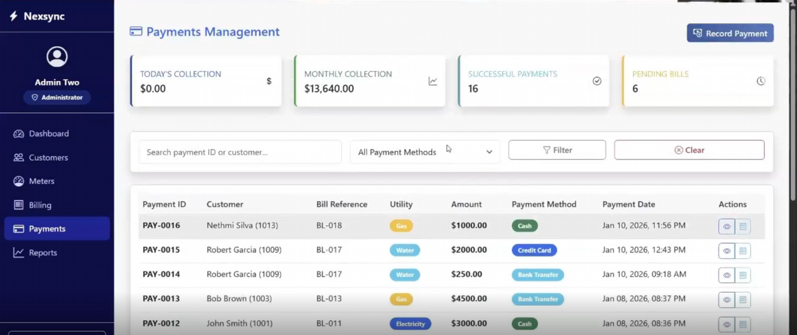<br><b>Payments management</b></td>
  </tr>
  <tr>
    <td align="center">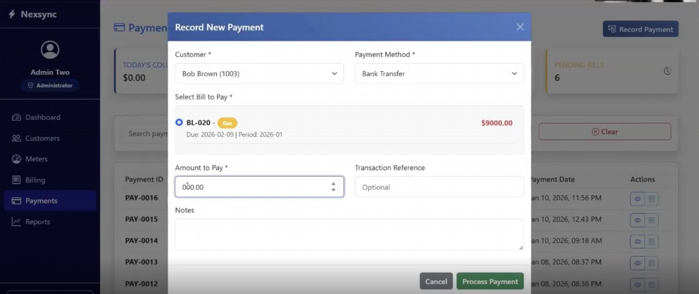<br><b>Record a payment</b>: full or partial</td>
    <td align="center">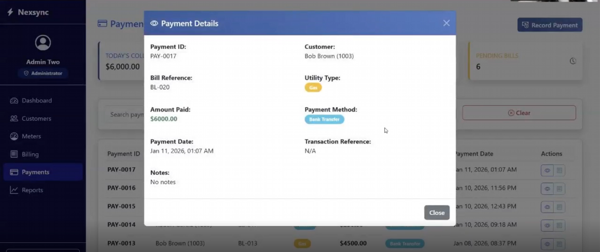<br><b>Payment details</b></td>
  </tr>
  <tr>
    <td align="center" colspan="2">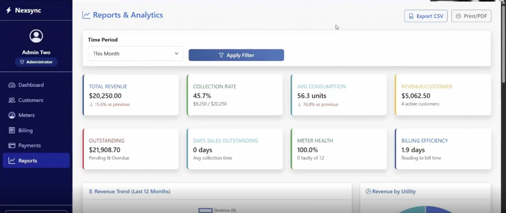<br><b>Reports & analytics</b>: revenue, collection rate, outstanding balance, meter health, CSV/PDF export</td>
  </tr>
</table>

### Customer portal

<p align="center">
  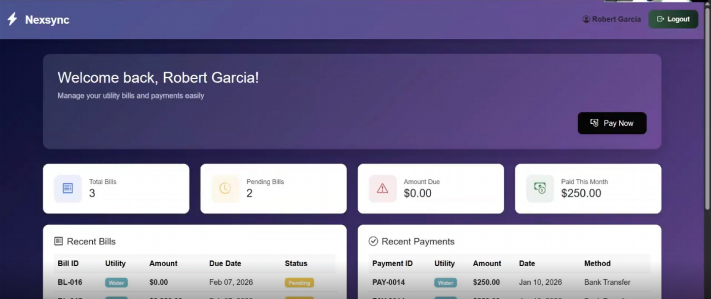<br>
  <b>Customer dashboard</b>: bills, payments and amount due
</p>

---

## 🧩 Database design

### Entities

```
UTILITY ──┬── ELECTRICITY   (voltage, phase type)
          ├── WATER         (water source, pipe size)
          └── GAS           (supply method, pressure type)

USER ─────┬── CUSTOMER        (address, connection date)
          ├── BILLING_OFFICER (department, assigned area)
          └── ADMINISTRATOR   (admin level)

CUSTOMER 1 ── N METER N ── 1 UTILITY
METER    1 ── N METER_READING
METER_READING 1 ── 1 BILL
CUSTOMER 1 ── N BILL
BILL     1 ── N PAYMENT
```

### Utilities covered

| Utility | Unit | Billing |
|---|---|---|
| Electricity | kWh | Tariff slabs by consumption |
| Water | m³ | Volume-based with fixed charges |
| Gas | m³ | Tariff-based |

### Design work included
EER diagram → relational mapping → normalisation (1NF → 2NF → 3NF) → data dictionary → SQL implementation with constraints, sample data, triggers, functions, views and procedures.

#### EER diagram
<p align="center">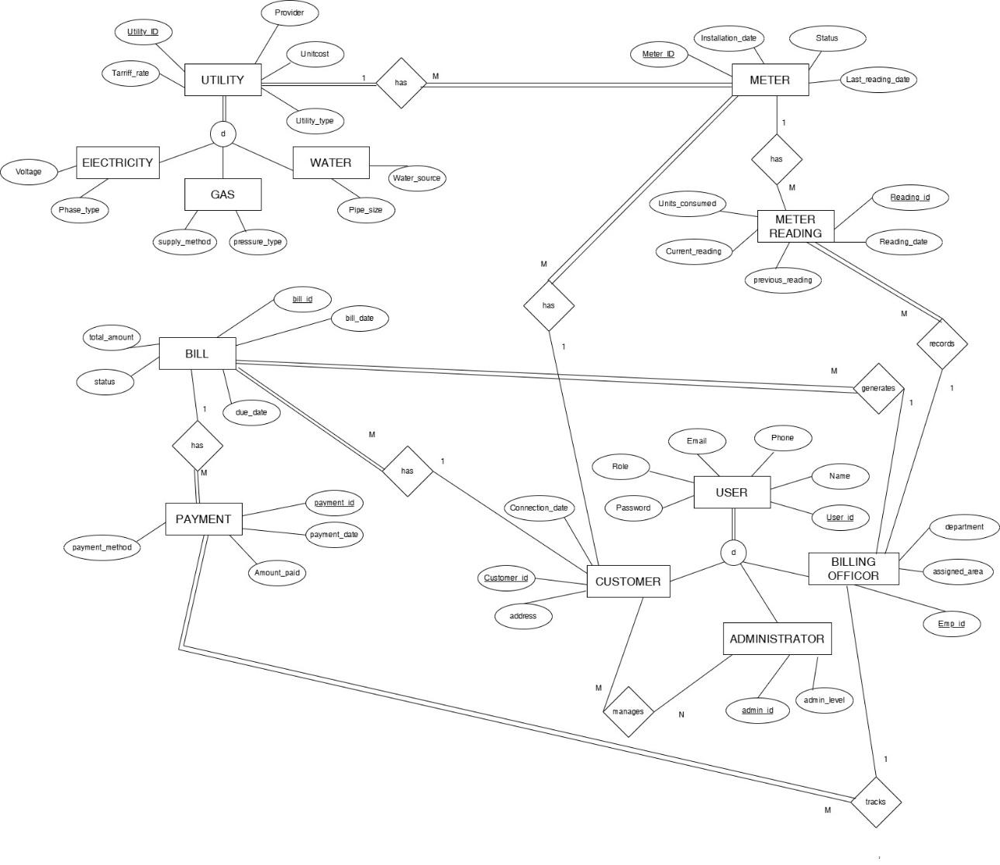</p>

#### Database diagram (SQL Server)
<p align="center">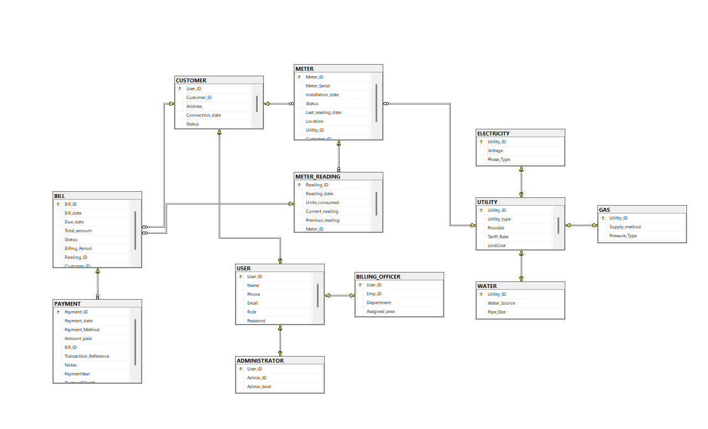</p>

<details>
<summary>Relational schema</summary>
<p align="center">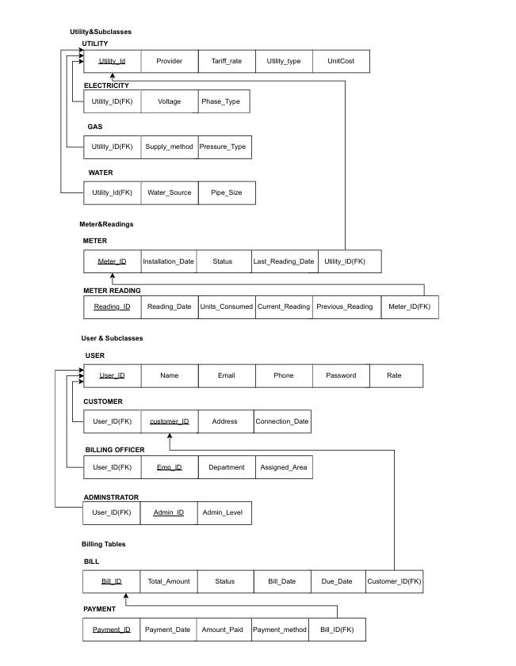</p>
</details>

---

## 👤 User roles

| Role | What they do |
|---|---|
| **Administrator** | Customer onboarding, connections, tariffs |
| **Billing Officer** | Meter readings, bills, payments |
| **Manager** | Reports and analysis |
| **Customer** | Views own bills and payments |

---

## 📂 Project structure

```
├── login.php / process_login.php / logout.php
├── dashboard.php               Admin dashboard
├── customer_dashboard.php      Customer view
├── customers.php               Customer management
├── meters.php                  Meter management
├── billing.php                 Bill generation & editing
├── payments.php                Payment recording & receipts
├── reports.php                 Reports & analytics
├── includes/
│   ├── sidebar.php
│   └── sidebar_styles.php
├── PHP/
│   ├── config.php              Database connection (PDO + sqlsrv)
│   ├── dashboard_stats.php
│   ├── get_unpaid_bills.php
│   ├── process_generate_bill.php
│   └── process_edit_bill.php
├── JS/dashboard.js
├── CSS/style.css
└── screenshots/                README images
```
---

## 🚀 Running it locally

### Requirements
- **Microsoft SQL Server** (the project uses LocalDB: `(localdb)\MSSQLLocalDB`)
- **SQL Server Management Studio** (or Azure Data Studio)
- **PHP 8** with the Microsoft **`sqlsrv` / `pdo_sqlsrv`** drivers enabled
- A web server (XAMPP/Apache or PHP's built-in server)

### Steps
1. **Clone the repo**
   ```bash
   git clone https://github.com/MenadiDev/Nexync.git
   cd Nexync
   ```
2. **Create the database**: create a database called `NexsyncDB` in SQL Server and run the project's SQL script to create the tables, triggers, functions, views, procedures and sample data.
3. **Enable the SQL Server drivers for PHP**: download the [Microsoft Drivers for PHP for SQL Server](https://learn.microsoft.com/en-us/sql/connect/php/download-drivers-php-sql-server), copy the DLLs into PHP's `ext` folder and add them to `php.ini`:
   ```ini
   extension=sqlsrv
   extension=pdo_sqlsrv
   ```
4. **Check the connection** in `PHP/config.php`: server name and database name.
5. **Start the server**
   ```bash
   php -S localhost:8000
   ```
   Then open <http://localhost:8000/login.php>.

> The SQL script isn't in this repository yet. Add it (for example as `database/nexsync.sql`) so others can set up the database.

---

## 🛣️ Future work

- Tiered and time-based tariffs (`TARIFF_SLAB` table)
- Service requests, meter maintenance logs and customer communication history
- Online payment gateway integration
- IoT smart meter readings
- Mobile apps for customers and field officers
- BI dashboards, consumption forecasting and fraud detection
- GIS meter mapping
- Multi-tenant support for several utility providers

---

## 🛠️ Tech stack

| Layer | Technology |
|---|---|
| Database | Microsoft SQL Server (T-SQL) |
| Backend | PHP (PDO, `sqlsrv`) |
| Frontend | HTML, CSS, JavaScript |

---

## 👥 Team (Group 115)

| Member | Contribution |
|---|---|
| **Pinnagodage Menadi** (Team Leader) | Advanced database features (triggers, functions, views, procedures), critical evaluation & SQL reference |
| Karavitalage Sandeepani | Advanced database features |
| Chakrawarthige Fernando | Critical evaluation & SQL reference |
| Ranasingha Hiranya | Critical evaluation & SQL reference |
| Kolonnagama Kolonnage | Database implementation |
| Kalavila Vithana | Database implementation |
| Maraka Weerasinghe | Database design |
| Mihidi Abeywickrama | Database design |

**Module lead:** Ms. Thisarani Wickramasinghe

---

<sub>Built for PUSL2019 Information Management & Retrieval at NSBM Green University (University of Plymouth), 2026.</sub>
